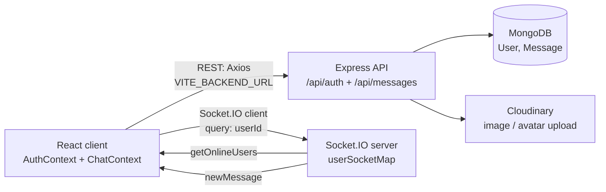

# Talksy — Real-Time Chat Application

Talksy is a full-stack one-to-one real-time chat application with JWT authentication, online presence, read receipts, text + image messaging, and profile management. It is built with **React (Vite)**, **Node.js / Express**, **MongoDB / Mongoose**, **Socket.IO**, and **Cloudinary**.

Repository: <https://github.com/adarsh1912-dev/chatApp>

> Note: the repository and source directories keep their existing names (`chatApp/`, `server/`). Only the user-facing project name is **Talksy**.

## Features

| Feature | Status | Implementation |
|---|---|---|
| User registration (`POST /api/auth/signup`) | Implemented | `server/controllers/userController.js` — `fullName`, `email`, `password`, `bio` required; duplicate-email check; bcryptjs hash (`genSalt(10)`); returns JWT + user without password |
| User login (`POST /api/auth/login`) | Implemented | bcrypt `compare`; generic "Invalid credentials" message; returns JWT + user without password |
| Session check (`GET /api/auth/check`) | Implemented | Protected; returns `req.user`; frontend calls it on load when a token exists in `localStorage` |
| JWT-protected routes | Implemented | `server/middleware/auth.js` (`protectRoute`) — accepts `Authorization: Bearer <token>` or a custom `token` header |
| Password hashing | Implemented | bcryptjs; password field has `minlength: 6` in the Mongoose schema |
| One-to-one text + image messaging | Implemented | `POST /api/messages/send/:id`; optional base64 `image` uploaded to Cloudinary; message persisted in MongoDB; emitted over Socket.IO to the receiver if online |
| Real-time delivery (Socket.IO) | Implemented | Server keeps `userSocketMap` (`{ userId: socketId }`); emits `newMessage` to the receiver's socket; client subscribes in `chatApp/context/ChatContext.jsx` |
| Online presence | Implemented | Server broadcasts `getOnlineUsers` (array of user IDs) on connect/disconnect; frontend stores it in `AuthContext` (`onlineUsers`) |
| Read receipts / unseen counts | Implemented | `Message.seen` boolean; `GET /api/messages/:id` marks the whole thread as seen via `updateMany`; `GET /api/messages/users` returns per-user `unseenMessages` counts |
| Sidebar user list with unseen badges | Implemented | `GET /api/messages/users` returns all users except the requester |
| Conversation history | Implemented | `GET /api/messages/:id` returns both directions (`$or` on `senderId`/`receiverId`); stored in `Message` collection with timestamps |
| Profile management | Implemented | `PUT /api/auth/update-profile` updates `fullName`, `bio`, and optional base64 `profilePic` (uploaded to Cloudinary) |
| React Context state management | Implemented | `AuthContext` (auth user, token, socket, online users) + `ChatContext` (users, selected user, messages, unseen counts) |
| Route guards | Implemented | `chatApp/src/App.jsx` — `/` and `/profile` require `authUser`, `/login` redirects to `/` when logged in |

## Tech Stack

| Layer | Technology |
|---|---|
| Frontend | React 19, Vite 8, Tailwind CSS 4 (`@tailwindcss/vite`), Axios, React Router 7, `socket.io-client`, `react-hot-toast` |
| Backend | Node.js, Express 5, Socket.IO 4, Mongoose 9 |
| Auth / security | `jsonwebtoken`, `bcryptjs` |
| Media | Cloudinary (`cloudinary` v2 SDK, backend-side upload) |
| Database | MongoDB (Mongoose `User` and `Message` models) |

## Architecture and Message Flow



Send-message flow (`POST /api/messages/send/:id`):

1. Frontend posts `{ text, image? }` (image as base64) with the auth token header.
2. Backend uploads `image` to Cloudinary (if present) and creates a `Message` document (`senderId`, `receiverId`, `text`, `image`, `seen: false`).
3. Backend looks up `userSocketMap[receiverId]`; if the receiver is connected, it emits `newMessage` to that socket.
4. The sender appends the returned `newMessage` from the REST response; the receiver appends it via the Socket.IO listener.

Read-receipt flow:

- Opening a conversation calls `GET /api/messages/:id`, which returns the thread and marks all messages from the selected user as `seen: true`.
- A live incoming message for the open conversation is optimistically marked seen client-side; other senders increment the `unseenMessages` badge map.

## Project Directory Structure

```text
chatApp/                        # repo root
├── readme.md                   # this file
├── chatApp/                    # frontend (React + Vite)
│   ├── context/
│   │   ├── AuthContext.jsx     # auth state, token, socket, online users
│   │   ├── AuthContextObject.js
│   │   └── ChatContext.jsx     # users, messages, selected user, unseen counts
│   ├── src/
│   │   ├── App.jsx             # routes: /, /login, /profile + guards
│   │   ├── main.jsx
│   │   ├── components/         # ChatContainer, SideBar, RightSideBar
│   │   ├── pages/              # HomePage, LoginPage, ProfilePage
│   │   ├── lib/utils.js        # formatMessageTime
│   │   └── assets/
│   └── package.json            # scripts: dev, build, lint, preview
└── server/                     # backend (Express + Socket.IO)
    ├── server.js               # app setup, Socket.IO, /api/status, /api/auth, /api/messages
    ├── routes/
    │   ├── userRoutes.js
    │   └── messageRoutes.js
    ├── controllers/
    │   ├── userController.js   # signup, login, checkAuth, updateProfile
    │   └── messageController.js # getUsersForSidebar, getMessages, markMessageAsSeen, sendMessage
    ├── models/
    │   ├── User.js
    │   └── Message.js
    ├── middleware/
    │   └── auth.js             # protectRoute
    ├── lib/
    │   ├── db.js               # connectDb (MONGODB_URI + /chat-app)
    │   ├── utils.js            # generateToken
    │   └── cloudinary.js
    └── package.json            # scripts: start, server
```

## Prerequisites

- Node.js (LTS) and npm
- A MongoDB connection string (Atlas or local)
- A Cloudinary account (cloud name, API key, API secret)
- Two terminals (frontend and backend run simultaneously)

## Installation and Local Setup

### 1. Clone the repository

```bash
git clone https://github.com/adarsh1912-dev/chatApp.git
cd chatApp
```

### 2. Backend setup

```bash
cd server
npm install
```

Create `server/.env` (see [Environment Variables](#environment-variables)):

```env
PORT=5000
MONGODB_URI=your_mongodb_connection_string
JWT_SECRET=your_jwt_secret
CLOUDINARY_CLOUD_NAME=your_cloudinary_cloud_name
CLOUDINARY_API_KEY=your_cloudinary_api_key
CLOUDINARY_API_SECRET=your_cloudinary_api_secret
```

Start the backend (from `server/`):

```bash
npm run server   # nodemon, for development
# or
npm start        # plain node
```

Backend runs at `http://localhost:5000` (or the value of `PORT`). Health check: `GET http://localhost:5000/api/status` returns `Server is live`.

### 3. Frontend setup

Open a second terminal (from the repo root):

```bash
cd chatApp
npm install
```

Create `chatApp/.env`:

```env
VITE_BACKEND_URL=http://localhost:5000
```

Start the frontend (from `chatApp/`):

```bash
npm run dev
```

Open the Vite URL shown in the terminal (default `http://localhost:5173`).

## Environment Variables

| File | Variable | Required | Used in |
|---|---|---|---|
| `server/.env` | `PORT` | No (defaults to `5000`) | `server/server.js` |
| `server/.env` | `MONGODB_URI` | Yes | `server/lib/db.js` — connects to `` `${MONGODB_URI}/chat-app` ``, so do not append a database name yourself unless you adjust the code |
| `server/.env` | `JWT_SECRET` | Yes | `server/lib/utils.js`, `server/middleware/auth.js` |
| `server/.env` | `CLOUDINARY_CLOUD_NAME` | Yes (for image/avatar uploads) | `server/lib/cloudinary.js` |
| `server/.env` | `CLOUDINARY_API_KEY` | Yes (for image/avatar uploads) | `server/lib/cloudinary.js` |
| `server/.env` | `CLOUDINARY_API_SECRET` | Yes (for image/avatar uploads) | `server/lib/cloudinary.js` |
| `chatApp/.env` | `VITE_BACKEND_URL` | Yes | `chatApp/context/AuthContext.jsx` — base URL for Axios and the Socket.IO client |

Never commit real `.env` values. Use placeholder values as shown above.

## Frontend and Backend Commands

Verified against the actual `package.json` files.

### Frontend (`chatApp/`)

| Command | Purpose |
|---|---|
| `npm run dev` | Start the Vite development server |
| `npm run build` | Production build (`vite build`) |
| `npm run preview` | Preview the production build locally |
| `npm run lint` | Run ESLint (`eslint .`) |

### Backend (`server/`)

| Command | Purpose |
|---|---|
| `npm run server` | Start with `nodemon server.js` (development) |
| `npm start` | Start with `node server.js` (production-like) |

## API Endpoint Documentation

Base URL: `http://localhost:5000` (or `$PORT`). All endpoints below return HTTP 200 with a `{ success: true/false, ... }` JSON body, including on errors, except the auth middleware which returns HTTP 401 for missing/invalid tokens/users.

### Health

| Method | Path | Auth | Purpose |
|---|---|---|---|
| `GET` | `/api/status` | No | Returns `Server is live` |

### Auth (`server/routes/userRoutes.js` → `userController.js`)

| Method | Path | Auth | Purpose | Body |
|---|---|---|---|---|
| `POST` | `/api/auth/signup` | No | Register; `bio` is currently required | `{ fullName, email, password, bio }` → `{ success, userData, token, message }` |
| `POST` | `/api/auth/login` | No | Login | `{ email, password }` → `{ success, userData, token, message }` |
| `GET` | `/api/auth/check` | Yes | Verify session, returns current user | — |
| `PUT` | `/api/auth/update-profile` | Yes | Update `fullName`, `bio`, optional base64 `profilePic` (Cloudinary upload) | `{ fullName?, bio?, profilePic? }` |

Auth header: `Authorization: Bearer <token>` **or** a custom `token: <token>` header (see `server/middleware/auth.js`). The frontend sends the custom `token` header via an Axios interceptor and persists the JWT in `localStorage`.

### Messages (`server/routes/messageRoutes.js` → `messageController.js`)

| Method | Path | Auth | Purpose |
|---|---|---|---|
| `GET` | `/api/messages/users` | Yes | List all users except the requester, plus `unseenMessages` map (`{ senderId: count }`) |
| `GET` | `/api/messages/:id` | Yes | Get the full two-way thread with user `:id`; also marks that thread's incoming messages as seen |
| `GET` | `/api/messages/mark/:id` | Yes | Mark a single message `:id` as seen |
| `POST` | `/api/messages/send/:id` | Yes | Send to user `:id`; body `{ text?, image? }` (`image` is base64, uploaded to Cloudinary); returns `{ success, newMessage }` and emits `newMessage` over Socket.IO if the receiver is online |

No other API routes exist. There is no logout, delete-message, edit-message, group-chat, typing-indicator, or pagination endpoint.

### Socket.IO events (`server/server.js`)

| Event | Direction | Payload | Purpose |
|---|---|---|---|
| `connection` with `query: { userId }` | Client → server | User ID | Register `userSocketMap[userId] = socket.id` |
| `getOnlineUsers` | Server → all clients | `string[]` (user IDs) | Emitted on connect and disconnect |
| `newMessage` | Server → receiver socket | `Message` document | Live delivery of a newly sent message |
| `disconnect` | Client → server | — | Removes the user from `userSocketMap`, re-broadcasts `getOnlineUsers` |

## Authentication and Security Notes

- Passwords are hashed with bcryptjs (`genSalt(10)`) and never returned by the API (`.select('-password')`).
- JWTs are signed with `JWT_SECRET` but currently have **no expiry** (`jwt.sign({ userId })` with no `expiresIn`).
- Tokens are stored in browser `localStorage` and attached to every Axios request — convenient but vulnerable to XSS; an HttpOnly-cookie session would be safer.
- CORS is fully open (`cors()` with default settings) and Socket.IO accepts any origin — fine for local development, too permissive for production.
- Socket.IO trusts the client-supplied `userId` query parameter; there is no handshake-token verification.
- `express.json({ limit: '4mb' })` caps base64 image/avatar payloads at ~4 MB.
- Auth/signup/login failures return HTTP 200 with `success: false` instead of 4xx status codes (except the middleware's 401s).

## Known Limitations

These were verified against the code in this repository:

1. **The previous project name no longer appears in this README** (verified with a case-insensitive search). Source files were intentionally not renamed per the task instructions.
2. **`bio` is required at signup** (`Missing Details` if omitted) even though the `User` schema marks `bio` as optional — the controller is stricter than the model.
3. **Read-receipt route/method mismatch**: the backend defines `GET /api/messages/mark/:id`, but `chatApp/context/ChatContext.jsx` calls `axios.put(...)` for live incoming messages. That `PUT` request has no matching route (Express 5 returns 404); marking still happens via `GET /api/messages/:id` when the thread is opened, but the live-mark path is broken.
4. **`GET /api/messages/:id` has a side effect**: fetching history marks messages as seen, so a plain read mutates state.
5. **No token expiry, no logout endpoint, no password reset/change**, and no refresh-token rotation. "Logout" is client-side only (clears `localStorage`, disconnects the socket).
6. **No group chats, typing indicators, message editing/deletion, pagination, or search** — only one-to-one threads with full-history fetch.
7. **Single-socket-per-user**: `userSocketMap` stores one socket ID per user, so a second device/tab overwrites the first and only the latest receives `newMessage`.
8. **Open CORS / open Socket.IO origins** and **client-controlled Socket.IO identity** (see Security Notes).
9. **No `LICENSE` file** in the repository; both `package.json` files declare `"license": "ISC"`. The section below reflects that declaration, not a verified license text.
10. **`MONGODB_URI` handling**: `lib/db.js` appends `/chat-app` to whatever value is configured, so a URI that already includes a database name will produce an unexpected path.

## Potential Future Improvements

- Add JWT expiry + refresh tokens; move the session token to an HttpOnly cookie.
- Fix the `mark/:id` method mismatch (use one method on both sides) and make history-fetch (`GET /:id`) read-only with an explicit mark-seen call.
- Add message pagination, search, edit/delete, delivery receipts, and typing indicators.
- Support multiple simultaneous sessions per user (socket-ID sets instead of a single entry).
- Verify the Socket.IO handshake with the JWT instead of trusting a query parameter.
- Restrict CORS / Socket.IO origins via environment configuration for production.
- Return proper HTTP status codes (400/401/404) instead of 200-with-`success: false`.
- Make `bio` optional end-to-end (or document it as required), add input validation and rate limiting.
- Add automated tests, CI, Docker Compose for local MongoDB, and a production deployment guide.
- Add a `LICENSE` file matching the intended license.

## License

No `LICENSE` file is present in this repository. Both `server/package.json` and `chatApp/package.json` declare `ISC`, so this project is described as ISC-licensed. Add a `LICENSE` file if you need a formal license text.
